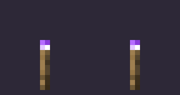

# 禁止火把 (Interdiction Torch)

《等价交换》中禁止火把的 Fabric 26.3 移植版本。

火把放置后生成力场，将敌对生物推出范围并偏转靠近的弹射物。照明等级为 14，与原版火把相同。
火把的方块行为与粒子逻辑沿用原版实现，贴图配色改为紫黑把手与紫色火焰。



## 特性

- 落地与贴墙两种形态，由一个物品放置
- 光照等级 14
- 力场半径为 8 格，推力随距离递减，多根火把的推力按矢量叠加
- 靠近火把的弹射物被反射
- 自定义紫色火焰粒子，生成位置、运动与缩放沿用原版 `FlameParticle`

力场作用于敌对生物，玩家与友好生物不受影响。

## 环境要求

| 项目 | 版本 |
| --- | --- |
| Minecraft | 26.3 |
| Fabric Loader | 0.20.1 或更高 |
| Fabric API | 0.165.2+26.3 或更高 |
| Java | 25 |

## 安装

1. 安装 Fabric Loader（26.3）
2. 将 Fabric API 与本模组的 jar 放入 `mods/` 目录
3. 启动游戏

## 合成

```
R D R      R = 红石火把
D   D      D = 钻石
G G G      G = 荧石粉
```

产出 1 个禁止火把。合成表中心为空，原版配方在此位置使用贤者之石。

## 从源码构建

```powershell
# 需要 JDK 25
$env:JAVA_HOME='C:\Path\temurin25-jdk-25.0.5+8'
.\gradlew build
```

产物位于 `build/libs/InterdictionTorch-<version>.jar`。

开发环境客户端：

```powershell
.\gradlew runClient
```

## 项目结构

```
src/main/java/com/ribu/interdictiontorch/
├── InterdictionTorch.java            主入口
├── ModBlocks.java                    方块注册
├── ModBlockEntities.java             方块实体注册
├── ModItems.java                     物品注册
├── ModParticles.java                 粒子类型注册
└── block/
    ├── InterdictionTorchBlock.java           落地火把
    ├── InterdictionWallTorchBlock.java       贴墙火把
    └── InterdictionTorchBlockEntity.java     力场逻辑

src/client/java/com/ribu/interdictiontorch/client/
├── InterdictionTorchClient.java      客户端入口
└── particle/InterdictionFlameParticle.java
```

## 实现说明

Minecraft 26.1 起官方发行版不再混淆，Fabric 同时停止维护 Yarn 映射，因此本项目使用 Mojang
官方类名（例如 `TorchBlock`、`Item.Properties`）。

方块与物品的以下行为与原版火把一致：碰撞箱、支撑判定、光照、音效、活塞与水流的反应、
战利品表、`wall_post_override` 与 `washed_away_by_fluids` 标签，以及 `animateTick`
中的粒子生成位置与速度。

## 许可

MIT，见 [LICENSE](LICENSE)。
